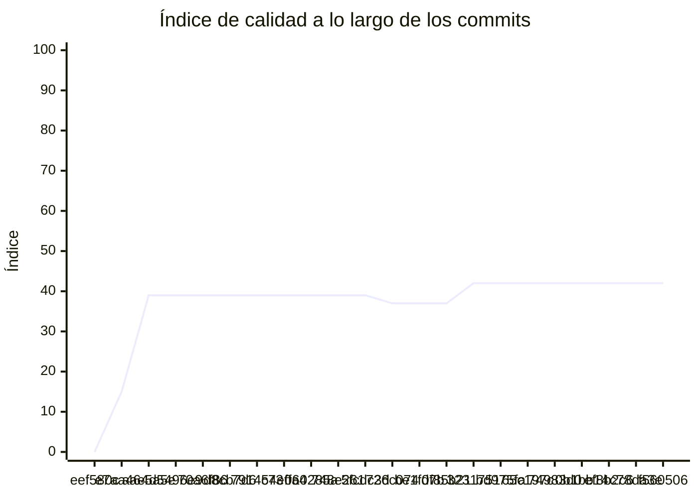

<!-- evaluacion:inicio -->
# Evaluación — pr2-camus/tp-catalogo-sincronizacion

> Documento **generado automáticamente** por la cátedra de Programación II (UM): RepoSense + análisis de calidad de **7 dimensiones**. **No editar a mano**: se regenera en cada evaluación.
> Rama evaluada: `main`. Análisis **heurístico** (regex + métricas) + build: es una criba para orientar la revisión, **no una nota**. La **documentación** del repositorio no se evalúa.
> Generado: 2026-11-12.

## 1. Veredicto

| Aspecto | Resultado |
|---|---|
| Índice de calidad | **42/100** |
| Tipo de repositorio | `backend` |
| Build (`mvnw verify` / `gradlew check`) | no compila |
| Código (LOC) | 4,188 |
| Archivos de código | 107 |
| Clases | 93 |
| Código dentro de clases (%POO) | 79% |
| Funciones fuera de clases | 0 |
| Duplicación (puerta) | 10.4% |
| Duplicación lógica | 11.2% |
| Duplicación de boilerplate | 1.3% |
| Tope duro aplicado a D1 | `POO_BAJO` → D1 ≤ 60 |

> Este informe **describe** lo que el análisis midió con los criterios ya establecidos de la materia. No es una nota.

## 2. Semáforo de aprobación

Criterios de la cátedra (`CRITERIOS-CALIDAD.md`): **Aprobar** se juega con el perfil `estandar`; **destacar**, con el `exigente` (meta de excelencia).

| Semáforo | Resultado |
|---|---|
| Aprobar (`estandar`) | **no cumple** — 3/11 |
| Destacar (`exigente`) | **no cumple** — 2/11 |

**Para aprobar, falta cumplir:** SOLID; Hexagonal; Duplicación; SQL

**Para destacar, falta cumplir:** SOLID; POO; Hexagonal; Duplicación; SQL

## 3. Autoría (RepoSense)

| Autor | Commits | Código (LOC) | Tests (LOC) | Docs (LOC) | Días activos | % del código |
|---|---:|---:|---:|---:|---:|---:|
| zoecamus | 1 | 0 | 0 | 0 | 8 | 0% |

> _El LOC de autoría lo calcula RepoSense sobre el historial y puede diferir del LOC de código del análisis (que mira el estado de `main`)._

## 4. Dimensiones evaluadas

Cada dimensión indica **qué mide**, **por qué importa** y **tu resultado**. Cuando el puntaje queda por debajo de la referencia, se agregan preguntas para **investigar la causa** (no hay recetas).

| Dimensión | Peso | Puntaje |
|:--|--:|--:|
| **D1** Diseño OO, SOLID y patrones (20%) | 20% | 3 |
| **D2** Arquitectura hexagonal — backend (15%) | 15% | 0 |
| **D3** Frontend KMP: MVVM y buenas prácticas (10%) | 10% | N/A |
| **D4** Integración y contrato (10%) | 10% | 80 |
| **D5** Seguridad y robustez (10%) | 10% | 40 |
| **D6** Pruebas y cobertura (20%) | 20% | 50 |
| **D7** Proceso y entrega (15%) | 15% | 100 |

### D1. Diseño OO, SOLID y patrones (20%)

- **Qué mide:** Métricas orientadas a objetos (clases, métodos, campos, cohesión, acoplamiento, herencia) y proxies de SOLID, más patrones de diseño.
- **Por qué importa:** El eje de la materia es el buen uso de la POO y su arquitectura: un diseño con clases claras y poco acopladas es más fácil de entender, probar y cambiar.
- **Tu resultado:** **3/100**
- **Para investigar la causa:**
    - ¿Se pensó el modelo de clases antes de codificar o se agrupó después?
    - ¿Qué clases concentran muchas responsabilidades a la vez?
    - ¿Los colaboradores llegan como parámetros o se crean por dentro?

### D2. Arquitectura hexagonal — backend (15%)

- **Qué mide:** Separación en capas (dominio, puertos de entrada/salida, adaptadores) y dirección de las dependencias del backend.
- **Por qué importa:** Aislar el dominio de la infraestructura permite cambiar la base de datos, el framework o el transporte sin tocar las reglas de negocio.
- **Tu resultado:** **0/100**
- **Para investigar la causa:**
    - ¿El dominio importa framework o detalles de persistencia?
    - ¿Dónde vive la lógica de negocio frente a los controladores?
    - ¿Se definieron puertos para los servicios que se consumen?

### D4. Integración y contrato (10%)

- **Qué mide:** Cumplimiento del contrato de integración de la cátedra (formato de errores, paginación, autenticación, endpoints esperados).
- **Por qué importa:** Los servicios deben poder integrarse entre sí y con la app sin sorpresas; el contrato es lo que hacen cumplir las pruebas de integración.
- **Tu resultado:** **80/100**

### D5. Seguridad y robustez (10%)

- **Qué mide:** Credenciales embebidas, consultas SQL por concatenación, y presencia de config de entorno; aislamiento de secretos.
- **Por qué importa:** Un secreto en el repositorio o una consulta construida por concatenación son riesgos concretos, no hipotéticos.
- **Tu resultado:** **40/100**
- **Para investigar la causa:**
    - ¿De dónde salen las credenciales que usa el sistema?
    - ¿Qué consultas se arman con texto en vez de parámetros?
    - ¿Qué pasa si falta una variable de entorno al arrancar?

### D6. Pruebas y cobertura (20%)

- **Qué mide:** Cantidad y resultado de pruebas y cobertura de línea (JaCoCo/Kover, Surefire/Failsafe) cuando hay build.
- **Por qué importa:** Las pruebas son la red de seguridad para refactorizar e integrar; la cobertura acota las zonas sin verificar.
- **Tu resultado:** **50/100**
- **Para investigar la causa:**
    - ¿Qué partes del sistema no tienen pruebas?
    - ¿Las pruebas cubren caminos de error o solo el caso feliz?
    - ¿Qué falla al ejecutar la suite completa (no solo la del módulo propio)?

### D7. Proceso y entrega (15%)

- **Qué mide:** Artefactos verificables de proceso/entrega: `compose`, `.env.example`, CI (`.github/workflows/`), `CODEOWNERS` y wrapper de build (`mvnw`/`gradlew`). **No** puntúa documentación.
- **Por qué importa:** Un proyecto que compila, se levanta y se valida solo es más fácil de revisar y de integrar en equipo.
- **Tu resultado:** **100/100**

## 5. Señales detectadas

El análisis encontró las siguientes señales (archivo, sin número de línea a propósito):

**SRP/responsabilidad** (52)
- clase 'CatalogoApp' grande (LOC=80, métodos=10, campos=2) — `src/main/java/ar/edu/um/prog2/camus/catalogo/CatalogoApp.java`
- método 'CatalogoApp.logApplicationStartup' de 35 líneas — `src/main/java/ar/edu/um/prog2/camus/catalogo/CatalogoApp.java`
- clase 'SnapshotRestAdapter' grande (LOC=100, métodos=10, campos=1) — `src/main/java/ar/edu/um/prog2/camus/catalogo/sync/infrastructure/client/SnapshotRestAdapter.java`
- método 'SnapshotRestAdapter.mapToDomain' de 54 líneas — `src/main/java/ar/edu/um/prog2/camus/catalogo/sync/infrastructure/client/SnapshotRestAdapter.java`
- método 'SnapshotRestAdapter.CategoriaDto' con 6 parámetros — `src/main/java/ar/edu/um/prog2/camus/catalogo/sync/infrastructure/client/SnapshotRestAdapter.java`
- método 'CategoriaDto.CategoriaDto' con 6 parámetros — `src/main/java/ar/edu/um/prog2/camus/catalogo/sync/infrastructure/client/SnapshotRestAdapter.java`
- método 'SyncToLatestUseCaseImpl.sincronizarAlDia' de 34 líneas — `src/main/java/ar/edu/um/prog2/camus/catalogo/sync/application/usecases/SyncToLatestUseCaseImpl.java`
- método 'SyncToLatestUseCaseImpl.sincronizarAlDia' con complejidad 6 — `src/main/java/ar/edu/um/prog2/camus/catalogo/sync/application/usecases/SyncToLatestUseCaseImpl.java`
- método 'SyncToLatestUseCaseImpl.aplicarVersion' de 37 líneas — `src/main/java/ar/edu/um/prog2/camus/catalogo/sync/application/usecases/SyncToLatestUseCaseImpl.java`
- método 'SyncToLatestUseCaseImpl.aplicarVersion' con complejidad 8 — `src/main/java/ar/edu/um/prog2/camus/catalogo/sync/application/usecases/SyncToLatestUseCaseImpl.java`
- clase 'Snapshot' con baja cohesión (11%) — `src/main/java/ar/edu/um/prog2/camus/catalogo/sync/domain/model/Snapshot.java`
- clase 'SecurityUtils' grande (LOC=84, métodos=10, campos=2) — `src/main/java/ar/edu/um/prog2/camus/catalogo/security/SecurityUtils.java`
- clase 'LoggingAspect' grande (LOC=100, métodos=13, campos=1) — `src/main/java/ar/edu/um/prog2/camus/catalogo/aop/logging/LoggingAspect.java`
- clase 'CatalogoRepositoryAdapter' con baja cohesión (14%) — `src/main/java/ar/edu/um/prog2/camus/catalogo/catalog/infrastructure/persistence/adapter/CatalogoRepositoryAdapter.java`
- clase 'SyncStateEntity' con baja cohesión (14%) — `src/main/java/ar/edu/um/prog2/camus/catalogo/catalog/infrastructure/persistence/entity/SyncStateEntity.java`
- clase 'WeeklyScheduleEntity' grande (LOC=75, métodos=19, campos=9) — `src/main/java/ar/edu/um/prog2/camus/catalogo/catalog/infrastructure/persistence/entity/WeeklyScheduleEntity.java`
- clase 'WeeklyScheduleEntity' con baja cohesión (5%) — `src/main/java/ar/edu/um/prog2/camus/catalogo/catalog/infrastructure/persistence/entity/WeeklyScheduleEntity.java`
- clase 'CategoryEntity' grande (LOC=50, métodos=13, campos=6) — `src/main/java/ar/edu/um/prog2/camus/catalogo/catalog/infrastructure/persistence/entity/CategoryEntity.java`
- clase 'CategoryEntity' con baja cohesión (8%) — `src/main/java/ar/edu/um/prog2/camus/catalogo/catalog/infrastructure/persistence/entity/CategoryEntity.java`
- clase 'ProfessionalEntity' grande (LOC=59, métodos=15, campos=7) — `src/main/java/ar/edu/um/prog2/camus/catalogo/catalog/infrastructure/persistence/entity/ProfessionalEntity.java`
- clase 'ProfessionalEntity' con baja cohesión (7%) — `src/main/java/ar/edu/um/prog2/camus/catalogo/catalog/infrastructure/persistence/entity/ProfessionalEntity.java`
- clase 'ProfessionalController' con baja cohesión (17%) — `src/main/java/ar/edu/um/prog2/camus/catalogo/catalog/infrastructure/web/ProfessionalController.java`
- clase 'CategoriaProfesional' grande (LOC=45, métodos=13, campos=6) — `src/main/java/ar/edu/um/prog2/camus/catalogo/catalog/domain/model/CategoriaProfesional.java`
- clase 'CategoriaProfesional' con baja cohesión (8%) — `src/main/java/ar/edu/um/prog2/camus/catalogo/catalog/domain/model/CategoriaProfesional.java`
- clase 'HorarioSemanal' grande (LOC=66, métodos=19, campos=9) — `src/main/java/ar/edu/um/prog2/camus/catalogo/catalog/domain/model/HorarioSemanal.java`
- clase 'HorarioSemanal' con baja cohesión (5%) — `src/main/java/ar/edu/um/prog2/camus/catalogo/catalog/domain/model/HorarioSemanal.java`
- clase 'Profesional' grande (LOC=52, métodos=15, campos=7) — `src/main/java/ar/edu/um/prog2/camus/catalogo/catalog/domain/model/Profesional.java`
- clase 'Profesional' con baja cohesión (7%) — `src/main/java/ar/edu/um/prog2/camus/catalogo/catalog/domain/model/Profesional.java`
- clase 'SecurityMetersService' grande (LOC=35, métodos=7, campos=8) — `src/main/java/ar/edu/um/prog2/camus/catalogo/management/SecurityMetersService.java`
- clase 'SecurityMetersService' con baja cohesión (33%) — `src/main/java/ar/edu/um/prog2/camus/catalogo/management/SecurityMetersService.java`
- método 'SecurityConfiguration.filterChain' de 37 líneas — `src/main/java/ar/edu/um/prog2/camus/catalogo/config/SecurityConfiguration.java`
- clase 'AbstractAuditingEntity' con baja cohesión (14%) — `src/main/java/ar/edu/um/prog2/camus/catalogo/domain/AbstractAuditingEntity.java`
- clase 'ExceptionTranslator' grande (LOC=219, métodos=26, campos=8) — `src/main/java/ar/edu/um/prog2/camus/catalogo/web/rest/errors/ExceptionTranslator.java`
- clase 'ExceptionTranslator' con baja cohesión (1%) — `src/main/java/ar/edu/um/prog2/camus/catalogo/web/rest/errors/ExceptionTranslator.java`
- método 'ExceptionTranslator.customizeProblem' de 30 líneas — `src/main/java/ar/edu/um/prog2/camus/catalogo/web/rest/errors/ExceptionTranslator.java`
- método 'ExceptionTranslator.customizeProblem' con complejidad 10 — `src/main/java/ar/edu/um/prog2/camus/catalogo/web/rest/errors/ExceptionTranslator.java`
- método 'ExceptionTranslator.getCustomizedErrorDetails' con complejidad 6 — `src/main/java/ar/edu/um/prog2/camus/catalogo/web/rest/errors/ExceptionTranslator.java`
- método 'ExceptionTranslator.getMappedStatus' con complejidad 6 — `src/main/java/ar/edu/um/prog2/camus/catalogo/web/rest/errors/ExceptionTranslator.java`
- método 'ExceptionTranslator.resolveCode' con complejidad 13 — `src/main/java/ar/edu/um/prog2/camus/catalogo/web/rest/errors/ExceptionTranslator.java`
- método 'SyncToLatestUseCaseImplTest.cuandoVersionLocalMenorQueActual_aplicaVersionesEnOrden' con complejidad 6 — `src/test/java/ar/edu/um/prog2/camus/catalogo/sync/application/usecases/SyncToLatestUseCaseImplTest.java`
- clase 'SecurityUtilsUnitTest' grande (LOC=86, métodos=10, campos=0) — `src/test/java/ar/edu/um/prog2/camus/catalogo/security/SecurityUtilsUnitTest.java`
- clase 'JwtAuthenticationTestUtils' grande (LOC=61, métodos=11, campos=1) — `src/test/java/ar/edu/um/prog2/camus/catalogo/security/jwt/JwtAuthenticationTestUtils.java`
- clase 'TokenAuthenticationSecurityMetersIT' con baja cohesión (48%) — `src/test/java/ar/edu/um/prog2/camus/catalogo/security/jwt/TokenAuthenticationSecurityMetersIT.java`
- método 'LoggingAspectTest.setup' con complejidad 6 — `src/test/java/ar/edu/um/prog2/camus/catalogo/aop/logging/LoggingAspectTest.java`
- clase 'DateTimeWrapper' grande (LOC=96, métodos=19, campos=9) — `src/test/java/ar/edu/um/prog2/camus/catalogo/repository/timezone/DateTimeWrapper.java`
- clase 'DateTimeWrapper' con baja cohesión (11%) — `src/test/java/ar/edu/um/prog2/camus/catalogo/repository/timezone/DateTimeWrapper.java`
- clase 'HibernateTimeZoneIT' grande (LOC=114, métodos=10, campos=8) — `src/test/java/ar/edu/um/prog2/camus/catalogo/config/timezone/HibernateTimeZoneIT.java`
- clase 'TestUtil' grande (LOC=145, métodos=15, campos=2) — `src/test/java/ar/edu/um/prog2/camus/catalogo/web/rest/TestUtil.java`
- método 'TestUtil.asDecimal' con complejidad 7 — `src/test/java/ar/edu/um/prog2/camus/catalogo/web/rest/TestUtil.java`
- método 'NumberMatcher.asDecimal' con complejidad 7 — `src/test/java/ar/edu/um/prog2/camus/catalogo/web/rest/TestUtil.java`
- clase 'ExceptionTranslatorTestController' grande (LOC=47, métodos=10, campos=1) — `src/test/java/ar/edu/um/prog2/camus/catalogo/web/rest/errors/ExceptionTranslatorTestController.java`
- clase 'ExceptionTranslatorIT' grande (LOC=97, métodos=10, campos=1) — `src/test/java/ar/edu/um/prog2/camus/catalogo/web/rest/errors/ExceptionTranslatorIT.java`

**DIP/concretos** (42)
- clase 'CatalogoApp' muy acoplada (CBO=24) — `src/main/java/ar/edu/um/prog2/camus/catalogo/CatalogoApp.java`
- clase 'CatalogUpdatedListener' muy acoplada (CBO=14) — `src/main/java/ar/edu/um/prog2/camus/catalogo/sync/infrastructure/messaging/CatalogUpdatedListener.java`
- clase 'SnapshotRestAdapter' muy acoplada (CBO=11) — `src/main/java/ar/edu/um/prog2/camus/catalogo/sync/infrastructure/client/SnapshotRestAdapter.java`
- clase 'SnapshotRestAdapter' instancia 4 concretos (CBO=11) — `src/main/java/ar/edu/um/prog2/camus/catalogo/sync/infrastructure/client/SnapshotRestAdapter.java`
- clase 'SyncService' muy acoplada (CBO=10) — `src/main/java/ar/edu/um/prog2/camus/catalogo/sync/application/service/SyncService.java`
- clase 'SyncToLatestUseCaseImpl' muy acoplada (CBO=23) — `src/main/java/ar/edu/um/prog2/camus/catalogo/sync/application/usecases/SyncToLatestUseCaseImpl.java`
- clase 'SyncToLatestUseCaseImpl' instancia 4 concretos (CBO=23) — `src/main/java/ar/edu/um/prog2/camus/catalogo/sync/application/usecases/SyncToLatestUseCaseImpl.java`
- clase 'RunFullSyncUseCaseImpl' muy acoplada (CBO=12) — `src/main/java/ar/edu/um/prog2/camus/catalogo/sync/application/usecases/RunFullSyncUseCaseImpl.java`
- clase 'SecurityUtils' muy acoplada (CBO=15) — `src/main/java/ar/edu/um/prog2/camus/catalogo/security/SecurityUtils.java`
- clase 'LoggingAspect' muy acoplada (CBO=24) — `src/main/java/ar/edu/um/prog2/camus/catalogo/aop/logging/LoggingAspect.java`
- clase 'JpaProfessionalRepository' muy acoplada (CBO=14) — `src/main/java/ar/edu/um/prog2/camus/catalogo/catalog/infrastructure/persistence/repository/JpaProfessionalRepository.java`
- clase 'CatalogoRepositoryAdapter' muy acoplada (CBO=11) — `src/main/java/ar/edu/um/prog2/camus/catalogo/catalog/infrastructure/persistence/adapter/CatalogoRepositoryAdapter.java`
- clase 'CatalogoRepositoryAdapter' instancia 4 concretos (CBO=11) — `src/main/java/ar/edu/um/prog2/camus/catalogo/catalog/infrastructure/persistence/adapter/CatalogoRepositoryAdapter.java`
- clase 'ProfessionalController' muy acoplada (CBO=12) — `src/main/java/ar/edu/um/prog2/camus/catalogo/catalog/infrastructure/web/ProfessionalController.java`
- clase 'WebConfigurer' muy acoplada (CBO=13) — `src/main/java/ar/edu/um/prog2/camus/catalogo/config/WebConfigurer.java`
- clase 'LiquibaseConfiguration' muy acoplada (CBO=18) — `src/main/java/ar/edu/um/prog2/camus/catalogo/config/LiquibaseConfiguration.java`
- clase 'CRLFLogConverter' muy acoplada (CBO=16) — `src/main/java/ar/edu/um/prog2/camus/catalogo/config/CRLFLogConverter.java`
- clase 'SecurityJwtConfiguration' muy acoplada (CBO=19) — `src/main/java/ar/edu/um/prog2/camus/catalogo/config/SecurityJwtConfiguration.java`
- clase 'SecurityConfiguration' muy acoplada (CBO=18) — `src/main/java/ar/edu/um/prog2/camus/catalogo/config/SecurityConfiguration.java`
- clase 'SecurityConfiguration' instancia 4 concretos (CBO=18) — `src/main/java/ar/edu/um/prog2/camus/catalogo/config/SecurityConfiguration.java`
- clase 'AsyncConfiguration' muy acoplada (CBO=12) — `src/main/java/ar/edu/um/prog2/camus/catalogo/config/AsyncConfiguration.java`
- clase 'AsyncConfiguration' instancia 3 concretos (CBO=12) — `src/main/java/ar/edu/um/prog2/camus/catalogo/config/AsyncConfiguration.java`
- clase 'BadRequestAlertException' muy acoplada (CBO=8) — `src/main/java/ar/edu/um/prog2/camus/catalogo/web/rest/errors/BadRequestAlertException.java`
- clase 'ExceptionTranslator' muy acoplada (CBO=75) — `src/main/java/ar/edu/um/prog2/camus/catalogo/web/rest/errors/ExceptionTranslator.java`
- clase 'TechnicalStructureTest' muy acoplada (CBO=10) — `src/test/java/ar/edu/um/prog2/camus/catalogo/TechnicalStructureTest.java`
- clase 'RunFullSyncUseCaseImplTest' muy acoplada (CBO=13) — `src/test/java/ar/edu/um/prog2/camus/catalogo/sync/application/usecases/RunFullSyncUseCaseImplTest.java`
- clase 'RunFullSyncUseCaseImplTest' instancia 7 concretos (CBO=13) — `src/test/java/ar/edu/um/prog2/camus/catalogo/sync/application/usecases/RunFullSyncUseCaseImplTest.java`
- clase 'SecurityUtilsUnitTest' muy acoplada (CBO=13) — `src/test/java/ar/edu/um/prog2/camus/catalogo/security/SecurityUtilsUnitTest.java`
- clase 'SecurityUtilsUnitTest' instancia 14 concretos (CBO=13) — `src/test/java/ar/edu/um/prog2/camus/catalogo/security/SecurityUtilsUnitTest.java`
- clase 'JwtAuthenticationTestUtils' muy acoplada (CBO=21) — `src/test/java/ar/edu/um/prog2/camus/catalogo/security/jwt/JwtAuthenticationTestUtils.java`
- clase 'JwtAuthenticationTestUtils' instancia 5 concretos (CBO=21) — `src/test/java/ar/edu/um/prog2/camus/catalogo/security/jwt/JwtAuthenticationTestUtils.java`
- clase 'LoggingAspectTest' muy acoplada (CBO=20) — `src/test/java/ar/edu/um/prog2/camus/catalogo/aop/logging/LoggingAspectTest.java`
- clase 'LoggingAspectTest' instancia 5 concretos (CBO=20) — `src/test/java/ar/edu/um/prog2/camus/catalogo/aop/logging/LoggingAspectTest.java`
- clase 'DateTimeWrapper' muy acoplada (CBO=11) — `src/test/java/ar/edu/um/prog2/camus/catalogo/repository/timezone/DateTimeWrapper.java`
- clase 'CRLFLogConverterTest' muy acoplada (CBO=12) — `src/test/java/ar/edu/um/prog2/camus/catalogo/config/CRLFLogConverterTest.java`
- clase 'CRLFLogConverterTest' instancia 9 concretos (CBO=12) — `src/test/java/ar/edu/um/prog2/camus/catalogo/config/CRLFLogConverterTest.java`
- clase 'WebConfigurerTest' muy acoplada (CBO=25) — `src/test/java/ar/edu/um/prog2/camus/catalogo/config/WebConfigurerTest.java`
- clase 'WebConfigurerTest' instancia 8 concretos (CBO=25) — `src/test/java/ar/edu/um/prog2/camus/catalogo/config/WebConfigurerTest.java`
- clase 'HibernateTimeZoneIT' muy acoplada (CBO=24) — `src/test/java/ar/edu/um/prog2/camus/catalogo/config/timezone/HibernateTimeZoneIT.java`
- clase 'TestUtil' muy acoplada (CBO=25) — `src/test/java/ar/edu/um/prog2/camus/catalogo/web/rest/TestUtil.java`
- clase 'TestUtil' instancia 6 concretos (CBO=25) — `src/test/java/ar/edu/um/prog2/camus/catalogo/web/rest/TestUtil.java`
- clase 'ExceptionTranslatorIT' muy acoplada (CBO=16) — `src/test/java/ar/edu/um/prog2/camus/catalogo/web/rest/errors/ExceptionTranslatorIT.java`

**LSP/overrides** (1)
- 'RunFullSyncUseCaseImpl.sincronizarIncremental' vacío o 'no implementado' — `src/main/java/ar/edu/um/prog2/camus/catalogo/sync/application/usecases/RunFullSyncUseCaseImpl.java`

**OCP/type-switch** (2)
- clase 'SecurityUtils' con 6 type-checks — `src/main/java/ar/edu/um/prog2/camus/catalogo/security/SecurityUtils.java`
- clase 'ExceptionTranslator' con 26 type-checks — `src/main/java/ar/edu/um/prog2/camus/catalogo/web/rest/errors/ExceptionTranslator.java`

**POO** (2)
- clase 'SecurityMetersService' con 4 campos públicos (encapsulación) — `src/main/java/ar/edu/um/prog2/camus/catalogo/management/SecurityMetersService.java`
- clase 'ErrorConstants' con 5 campos públicos (encapsulación) — `src/main/java/ar/edu/um/prog2/camus/catalogo/web/rest/errors/ErrorConstants.java`

**duplicación** (6)
- duplicación lógica: 10.4% · boilerplate: 1.3%
- bloque de 8 líneas repetido 7 veces en src/main/java/ar/edu/um/prog2/camus/catalogo/catalog/infrastructure/persistence/entity/SyncStateEntity.java:35, src/main/java/ar/edu/um/prog2/camus/catalogo/catalog/infrastructure/persistence/entity/WeeklyScheduleEntity.java:101, src/main/java/ar/edu/um/prog2/camus/catalogo/catalog/infrastructure/persistence/entity/CategoryEntity.java:67 — `src/main/java/ar/edu/um/prog2/camus/catalogo/catalog/infrastructure/persistence/entity/SyncStateEntity.java`
- bloque de 8 líneas repetido 6 veces en src/main/java/ar/edu/um/prog2/camus/catalogo/catalog/infrastructure/persistence/entity/WeeklyScheduleEntity.java:87, src/main/java/ar/edu/um/prog2/camus/catalogo/catalog/infrastructure/persistence/entity/CategoryEntity.java:53, src/main/java/ar/edu/um/prog2/camus/catalogo/catalog/infrastructure/persistence/entity/ProfessionalEntity.java:65 — `src/main/java/ar/edu/um/prog2/camus/catalogo/catalog/infrastructure/persistence/entity/WeeklyScheduleEntity.java`
- bloque de 8 líneas repetido 6 veces en src/main/java/ar/edu/um/prog2/camus/catalogo/catalog/infrastructure/persistence/entity/WeeklyScheduleEntity.java:95, src/main/java/ar/edu/um/prog2/camus/catalogo/catalog/infrastructure/persistence/entity/CategoryEntity.java:61, src/main/java/ar/edu/um/prog2/camus/catalogo/catalog/infrastructure/persistence/entity/ProfessionalEntity.java:73 — `src/main/java/ar/edu/um/prog2/camus/catalogo/catalog/infrastructure/persistence/entity/WeeklyScheduleEntity.java`
- bloque de 8 líneas repetido 6 veces en src/main/java/ar/edu/um/prog2/camus/catalogo/catalog/infrastructure/persistence/entity/WeeklyScheduleEntity.java:99, src/main/java/ar/edu/um/prog2/camus/catalogo/catalog/infrastructure/persistence/entity/CategoryEntity.java:65, src/main/java/ar/edu/um/prog2/camus/catalogo/catalog/infrastructure/persistence/entity/ProfessionalEntity.java:77 — `src/main/java/ar/edu/um/prog2/camus/catalogo/catalog/infrastructure/persistence/entity/WeeklyScheduleEntity.java`
- bloque de 8 líneas repetido 6 veces en src/main/java/ar/edu/um/prog2/camus/catalogo/catalog/infrastructure/persistence/entity/WeeklyScheduleEntity.java:91, src/main/java/ar/edu/um/prog2/camus/catalogo/catalog/infrastructure/persistence/entity/CategoryEntity.java:57, src/main/java/ar/edu/um/prog2/camus/catalogo/catalog/infrastructure/persistence/entity/ProfessionalEntity.java:69 — `src/main/java/ar/edu/um/prog2/camus/catalogo/catalog/infrastructure/persistence/entity/WeeklyScheduleEntity.java`

**arquitectura** (2)
- consulta SQL construida por concatenación/interpolación — `src/main/java/ar/edu/um/prog2/camus/catalogo/catalog/infrastructure/persistence/repository/JpaProfessionalRepository.java`
- consulta SQL construida por concatenación/interpolación — `src/main/java/ar/edu/um/prog2/camus/catalogo/catalog/infrastructure/persistence/repository/JpaProfessionalRepository.java`

**hexagonal** (10)
- domain importa framework/infra: import com.fasterxml.jackson.annotation.JsonIgnoreProperties; — `src/main/java/ar/edu/um/prog2/camus/catalogo/domain/AbstractAuditingEntity.java`
- domain importa framework/infra: import jakarta.persistence.Column; — `src/main/java/ar/edu/um/prog2/camus/catalogo/domain/AbstractAuditingEntity.java`
- domain importa framework/infra: import jakarta.persistence.EntityListeners; — `src/main/java/ar/edu/um/prog2/camus/catalogo/domain/AbstractAuditingEntity.java`
- domain importa framework/infra: import jakarta.persistence.MappedSuperclass; — `src/main/java/ar/edu/um/prog2/camus/catalogo/domain/AbstractAuditingEntity.java`
- domain importa framework/infra: import org.springframework.data.annotation.CreatedBy; — `src/main/java/ar/edu/um/prog2/camus/catalogo/domain/AbstractAuditingEntity.java`
- domain importa framework/infra: import org.springframework.data.annotation.CreatedDate; — `src/main/java/ar/edu/um/prog2/camus/catalogo/domain/AbstractAuditingEntity.java`
- domain importa framework/infra: import org.springframework.data.annotation.LastModifiedBy; — `src/main/java/ar/edu/um/prog2/camus/catalogo/domain/AbstractAuditingEntity.java`
- domain importa framework/infra: import org.springframework.data.annotation.LastModifiedDate; — `src/main/java/ar/edu/um/prog2/camus/catalogo/domain/AbstractAuditingEntity.java`
- domain importa framework/infra: import org.springframework.data.jpa.domain.support.AuditingEntityListener; — `src/main/java/ar/edu/um/prog2/camus/catalogo/domain/AbstractAuditingEntity.java`
- falta ports/out (hexagonal)

## 6. Evolución por commit

Métricas calculadas sobre el estado de `main` en **cada commit** (22 commits con trabajo), del primero al último. La calidad usa el perfil `exigente`; el aporte de código lo mide RepoSense. El índice puede **bajar** al crecer el proyecto: se acumulan señales.

| # | Fecha | Commit | Autor | LOC | Índice | %POO | Duplic. | Sueltas |
|---|---|---|---|---:|---:|---:|---:|---:|
| 1 | 2026-09-21 | `eef580c` | zoecamus | 0 | 0 | 0% | 0.0% | 0 |
| 2 | 2026-09-22 | `e7aa464` | Ing. Daniel Quinteros | 0 | 15 | 0% | 0.0% | 0 |
| 3 | 2026-10-23 | `aae5a5e` | zoecamus | 2,653 | 39 | 77% | 0.0% | 0 |
| 4 | 2026-10-23 | `d5496e9` | zoecamus | 3,024 | 39 | 77% | 3.1% | 0 |
| 5 | 2026-10-26 | `70a6f86` | zoecamus | 3,255 | 39 | 78% | 13.0% | 0 |
| 6 | 2026-10-27 | `d8cb7d6` | zoecamus | 3,389 | 39 | 79% | 12.4% | 0 |
| 7 | 2026-10-27 | `7914c73` | zoecamus | 3,627 | 39 | 78% | 11.6% | 0 |
| 8 | 2026-10-27 | `54effa4` | zoecamus | 3,698 | 39 | 78% | 11.4% | 0 |
| 9 | 2026-10-27 | `060285a` | zoecamus | 3,735 | 39 | 78% | 11.2% | 0 |
| 10 | 2026-10-27 | `748e261` | zoecamus | 3,898 | 39 | 79% | 10.7% | 0 |
| 11 | 2026-10-28 | `5fcdc3d` | zoecamus | 3,984 | 39 | 79% | 10.5% | 0 |
| 12 | 2026-10-28 | `726c074` | zoecamus | 4,089 | 37 | 79% | 10.2% | 0 |
| 13 | 2026-10-28 | `be1fd7b` | zoecamus | 4,157 | 37 | 79% | 10.0% | 0 |
| 14 | 2026-10-29 | `0f85b21` | zoecamus | 4,184 | 37 | 79% | 10.4% | 0 |
| 15 | 2026-10-29 | `3231751` | zoecamus | 4,184 | 42 | 79% | 10.4% | 0 |
| 16 | 2026-10-29 | `bd975fa` | zoecamus | 4,184 | 42 | 79% | 10.4% | 0 |
| 17 | 2026-10-29 | `65c197c` | zoecamus | 4,184 | 42 | 79% | 10.4% | 0 |
| 18 | 2026-10-29 | `74983d0` | zoecamus | 4,184 | 42 | 79% | 10.4% | 0 |
| 19 | 2026-11-03 | `0b1bb14` | zoecamus | 4,188 | 42 | 79% | 10.4% | 0 |
| 20 | 2026-11-03 | `ef8b2c6` | zoecamus | 4,188 | 42 | 79% | 10.4% | 0 |
| 21 | 2026-11-03 | `c78da3e` | zoecamus | 4,188 | 42 | 79% | 10.4% | 0 |
| 22 | 2026-11-03 | `f560506` | zoecamus | 4,188 | 42 | 79% | 10.4% | 0 |

---
_Informe generado por la cátedra. Las dimensiones y umbrales corresponden a `calidad.py` (perfil `exigente`); el semáforo, a `CRITERIOS-CALIDAD.md`. La documentación del repositorio no se evalúa. Ante dudas, revisá el archivo señalado._
<!-- evaluacion:fin -->
