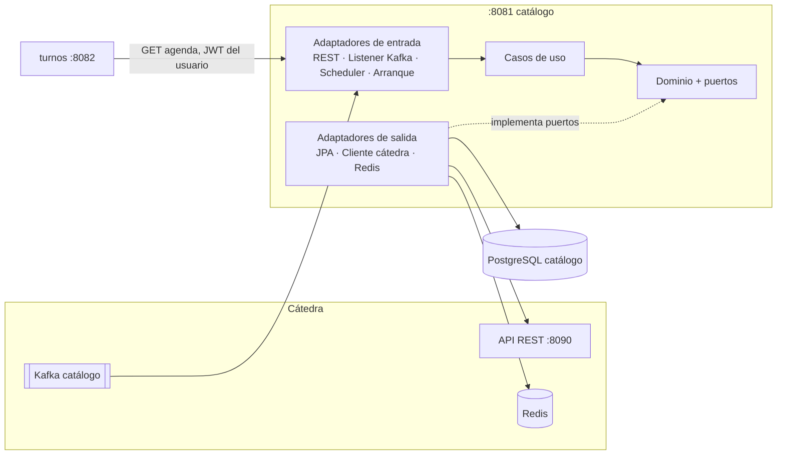

# Arquitectura (catálogo)

El servicio mantiene una **copia local y de solo lectura** del catálogo de la cátedra (categorías, profesionales, horarios semanales) y la expone a `turnos`. Sigue arquitectura hexagonal con dos agregados: `catalog` y `sync`.

## Capas por agregado

| Capa | Contenido | Regla |
|---|---|---|
| `domain/model`, `domain/ports/in`, `domain/ports/out` | modelos puros, un puerto de entrada por caso de uso, un puerto de salida por agregado | sin Spring ni JPA |
| `application/usecases`, `application/service` | `*UseCaseImpl` y la fachada `*Service` | solo depende del dominio |
| `infrastructure/persistence` | `adapter`, `entity`, `mapper`, `repository` | traduce entre entidad JPA y modelo |
| `infrastructure/web` | `controller`, `dto`, `mapper` | los DTO no salen de esta capa |
| `infrastructure/messaging`, `scheduling` | listener Kafka y scheduler | llaman al puerto de entrada |

`TechnicalStructureTest` (ArchUnit) hace cumplir estas dependencias en cada build.

## Decisiones

- **Un caso de uso por clase**: cada clase tiene una sola razón de cambio y se prueba sola con mocks de los puertos.
- **Entidades base** (`BaseEntity`, `CatalogEntity`) concentran `id`, `createdAt`, `updatedAt` y `enabled` para no repetirlos.
- **Mapeo en infraestructura**: el formato de los mensajes de la cátedra (Redis, snapshot) se traduce en adaptadores; el caso de uso trabaja con `CambiosCatalogo`.
