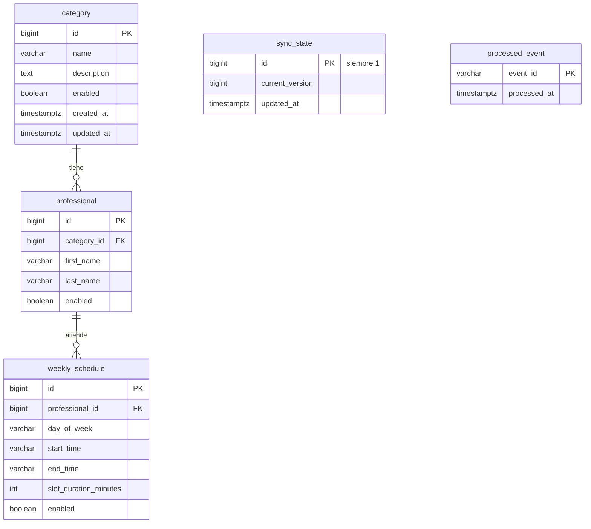

# Modelo de datos (catálogo)

Esquema creado por Liquibase (`liquibase/changelog/tablas_catalogo.xml` ejecuta `liquibase/sql/catalogo_tablas.sql`).

- Los `id` de `category`, `professional` y `weekly_schedule` **vienen de la cátedra** (no se generan acá), para poder aplicar cambios por id.
- `sync_state` tiene una sola fila (`id = 1`) con la última versión aplicada.
- `processed_event` guarda los eventos ya procesados (idempotencia).
- Las tablas de usuarios (`jhi_user`, `jhi_authority`) son las de JHipster.
