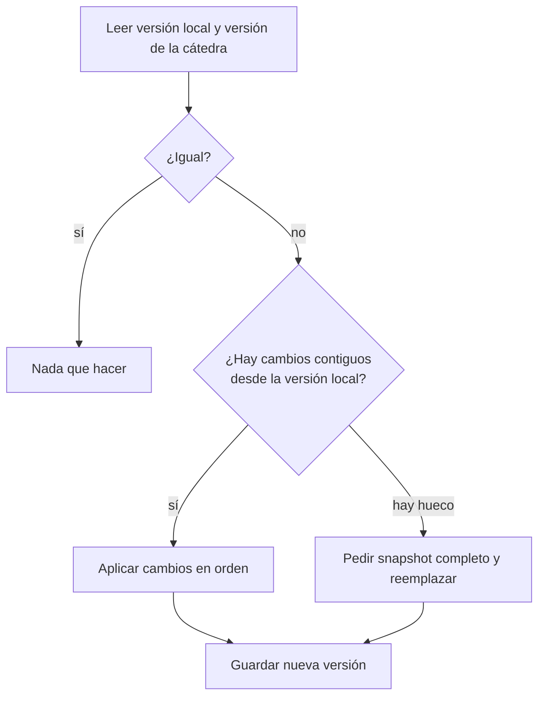

# Estrategia de sincronización, idempotencia y recuperación (catálogo)

## Disparadores

| Disparador | Clase | Qué hace |
|---|---|---|
| Arranque | `SincronizarAlArrancarUseCaseImpl` | sincroniza hasta la última versión de la cátedra |
| Periódico (`sync.intervalo-ms`, 5 min) | `SyncScheduler` | red de seguridad si se perdió un evento |
| Evento Kafka `CatalogUpdated` | `CatalogUpdatedListener` → `ProcesarEventoCatalogoUseCaseImpl` | sincroniza al instante |
| Manual `POST /api/sync/full` | `SyncService` | snapshot completo bajo demanda |

## Algoritmo (`SyncToLatestUseCaseImpl`)

Si falta algún cambio intermedio no se intenta adivinar: se descarga el **snapshot completo**, que siempre deja el estado correcto.

## Idempotencia

- Cada evento Kafka trae un `eventId`. Se registra en `processed_event` **en la misma transacción** que la sincronización.
- Un evento repetido se ignora (se confirma sin hacer nada).
- Aplicar dos veces el mismo cambio da el mismo resultado: las escrituras son *upsert* por `id`.

## Fallos y recuperación

| Situación | Resultado |
|---|---|
| Falla la sincronización al procesar un evento | rollback: el evento **no** queda como procesado y no se confirma (`ack`); Kafka lo vuelve a entregar |
| Cátedra caída al arrancar | se registra el error; el scheduler reintenta cada 5 min |
| Se perdió un evento | el scheduler detecta que la versión difiere y sincroniza |
| Hueco de versiones | snapshot completo |

El consumidor usa `ack-mode: manual` y `enable-auto-commit: false`, así que un mensaje solo se da por consumido si el procesamiento terminó bien.
